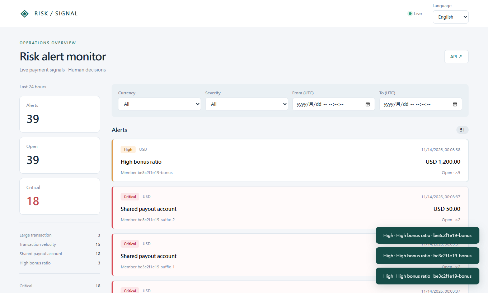
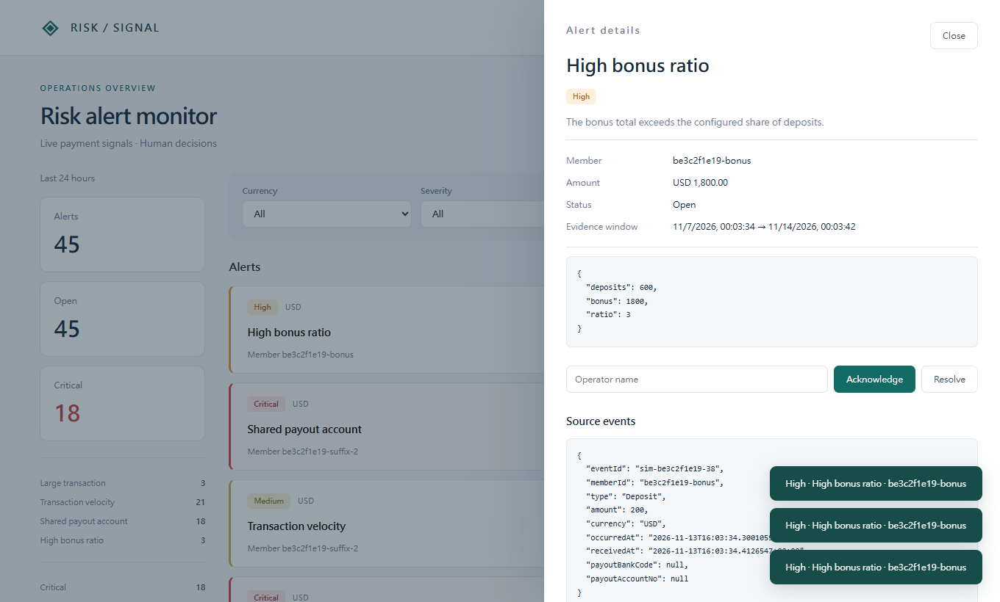
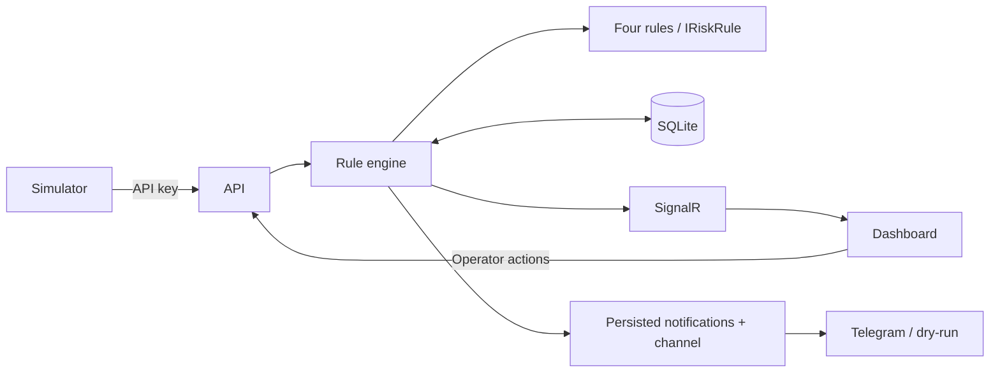

English | [繁體中文](README.zh-TW.md)

# Risk Alert Notifier

[](https://github.com/Marc-YULIN/risk-alert-notifier/actions/workflows/ci.yml)  

A configurable transaction risk monitor with a live dashboard and currency-aware Telegram delivery.

## Background

Distilled from patterns I built and operated in production payment / membership platforms. This repository is a clean-room implementation with synthetic data.

## Features

- Four configurable rules: large transactions, transaction velocity, shared payout accounts, and excessive bonus-to-deposit ratios.
- Idempotent ingestion, evidence windows, severity escalation, and rolling fingerprint deduplication.
- Live SignalR dashboard with filters, acknowledgment, resolution, evidence, and delivery history.
- English, Traditional Chinese, and Korean from one shared catalog.
- Per-currency notification switches, minimum severity, Telegram MarkdownV2, and automatic dry-run mode.
- Reproducible traffic patterns, isolated SQLite tests, and HTTP stubs for external delivery.

## Screenshots



*Live dashboard receiving alerts over SignalR*



*Alert detail with evidence window and source events*

## Architecture



See [architecture](docs/architecture.md) for sequence, lifecycle, and data diagrams.

## Tech Stack

.NET 10, ASP.NET Core Minimal APIs, EF Core SQLite, SignalR, Scalar, native JavaScript/CSS, xUnit, NSubstitute, and WebApplicationFactory. The dashboard loads the pinned SignalR 8.0.7 client from a CDN; other runtime components do not need a CDN.

## Getting Started

Install the SDK selected by `global.json`, then run from the repository root:

```sh
dotnet restore RiskAlert.slnx
dotnet build RiskAlert.slnx --no-restore
dotnet run --project src/RiskAlert.Api --no-restore
```

Open `http://localhost:5107` for the dashboard, `/scalar` for API exploration, and `/health` for liveness. In another terminal:

```sh
dotnet run --project tools/RiskAlert.EventSimulator --no-restore -- --api http://localhost:5107 --scenario all --duration 60 --rate 5 --members 50 --seed 42
```

Within four simulation ticks all four rule families can appear. The exact-account scenario works with default rules. To exercise the suffix variant, set `SHARED_PAYOUT_ACCOUNT` to `LastDigits` through the rules API, then run `--scenario shared-account`. Scenario bursts are additional to `--rate` normal events per second. `alertHits` counts both newly created and merged rule hits, rather than distinct alert rows. A seed reproduces traffic choices; event IDs and timestamps are unique for each run. Long or high-rate normal traffic can also meet the configured velocity threshold.

No token is needed: the notification worker stores dry-run content for inspection in alert details. SQLite files are created under the API working directory's `appdata` folder. The dashboard still refreshes every 15 seconds if its CDN client cannot load; live updates require CDN access.

With Docker:

```sh
docker compose up --build -d api
docker compose --profile simulator up --build simulator
```

The named volume preserves SQLite data. `docker compose down` retains that volume. The simulator waits for the API port to become healthy.

## Configuration

Use environment variables with `__` between configuration sections. Do not commit credentials.

| Key | Default | Description |
| --- | --- | --- |
| `ConnectionStrings:RiskAlert` | `Data Source=appdata/risk-alert-notifier.db` | SQLite path |
| `Security:IngestApiKey` | `dev-ingest-key` | Required `X-Api-Key` for event ingestion; replace before exposure |
| `Risk:DedupeWindowMinutes` | `30` | Rolling inactivity window for open/acknowledged alerts |
| `Risk:Rules:LARGE_TXN` | KRW 10,000,000; USD/USDT 10,000 | JSON string with `thresholds[currency][Deposit/Withdrawal]` |
| `Risk:Rules:VELOCITY` | 10 minutes; deposit 5, withdrawal 3 | JSON string with `windowMinutes`, `maxCount` |
| `Risk:Rules:SHARED_PAYOUT_ACCOUNT` | 30 days, Exact, 6 digits | JSON string with `lookbackDays`, `matchMode`, `digits` (1–6) |
| `Risk:Rules:BONUS_RATIO` | 7 days, 0.5; minimum KRW 100,000 or USD/USDT 100 | JSON string with `lookbackDays`, `maxRatio`, `minDeposit` |
| `Notifications:DisplayTimeZone` | `Asia/Taipei` | Notification local time, alongside UTC |
| `Notifications:Telegram:BotToken` | empty | Empty enables dry-run |
| `Notifications:Telegram:ChatId` | empty | Default Telegram destination |
| `Notifications:Telegram:Locale` | `en` | `en`, `zh-TW`, `ko`; unknown values fall back to English |
| `Dashboard:PublicUrl` | `http://localhost:5107` | Public notification landing URL |

Rule defaults seed missing DB rows only. Persisted settings take precedence thereafter; change them with `PUT /api/rules/{code}`. The cache lives for 30 seconds and is invalidated immediately on updates. A currency-specific notification row takes precedence over `*`; the initial `*` row is enabled at `Medium`.

For real delivery, use Telegram's BotFather to create a bot (`/newbot`) and securely retain its token. Send a message to the bot or add it to the intended group. Retrieve `message.chat.id` from the bot's `getUpdates` response in a private session; ensure polling has no conflicting webhook. Set these variables in your shell, then restart the API (PowerShell example):

```powershell
$env:Notifications__Telegram__BotToken = '<your-token>'
$env:Notifications__Telegram__ChatId = '<your-chat-id>'
$env:Notifications__Telegram__Locale = 'zh-TW'
$env:Dashboard__PublicUrl = 'https://alerts.example.test'
dotnet run --project src/RiskAlert.Api --no-restore
```

Compose uses the same environment names: copy `.env.example` to `.env` (git-ignored) or set them in the shell before `docker compose up`. Real delivery requires outbound HTTPS and a valid destination. Keep the dashboard private: only ingestion is authenticated in this demonstration. All read, configuration, and operator endpoints, the hub, and the dashboard require authentication/authorization, transport security, rate limits, and secret management before real deployment.

## API Walkthrough

Start the API, open the dashboard, and run the simulator as shown above. The following POSIX shell examples walk through manual ingestion and review; use `curl.exe` with equivalent quoting in PowerShell.

```sh
# Unique ID makes this example repeatable. Supply the current UTC event time.
EVENT_ID="demo-$(date +%s)"
NOW=$(date -u +%Y-%m-%dT%H:%M:%SZ)
curl -sS http://localhost:5107/api/events/transactions \
  -H 'X-Api-Key: dev-ingest-key' -H 'Content-Type: application/json' \
  -d "{\"eventId\":\"$EVENT_ID\",\"memberId\":\"sample-member\",\"type\":\"Deposit\",\"amount\":60001,\"currency\":\"USD\",\"occurredAt\":\"$NOW\"}"
curl -sS 'http://localhost:5107/api/alerts?currency=USD&severity=Critical&page=1&pageSize=50'

# Paste an ID from the preceding response.
ALERT_ID='<alert-id>'
curl -sS "http://localhost:5107/api/alerts/$ALERT_ID"
curl -sS "http://localhost:5107/api/notifications?alertId=$ALERT_ID"
curl -sS -X POST "http://localhost:5107/api/alerts/$ALERT_ID/acknowledge" \
  -H 'Content-Type: application/json' -d '{"by":"demo-operator"}'
curl -sS -X POST "http://localhost:5107/api/alerts/$ALERT_ID/resolve" \
  -H 'Content-Type: application/json' -d '{"by":"demo-operator"}'
curl -sS 'http://localhost:5107/api/stats/summary?hours=24'

# Disable USD notifications, then enable only High/Critical.
curl -sS -X PUT http://localhost:5107/api/notification-settings/USD \
  -H 'Content-Type: application/json' -d '{"enabled":false,"minSeverity":"High","chatIdOverride":null}'
curl -sS -X PUT http://localhost:5107/api/notification-settings/USD \
  -H 'Content-Type: application/json' -d '{"enabled":true,"minSeverity":"High","chatIdOverride":null}'

curl -sS http://localhost:5107/api/rules
curl -sS -X PUT http://localhost:5107/api/rules/SHARED_PAYOUT_ACCOUNT \
  -H 'Content-Type: application/json' \
  -d '{"enabled":true,"parameters":{"lookbackDays":30,"matchMode":"LastDigits","digits":6}}'
```

Repeat the identical `eventId` to receive `duplicate: true` without more alerts. Batch ingestion accepts 1–500 valid events and processes them sequentially; each event is atomic, while the whole batch is not transactional. Invalid batches are rejected before processing. List responses contain `items`, `total`, `page`, and `pageSize`. Notification queries return up to 500 records. Alert `from`/`to` filters select overlapping evidence windows. Summary statistics count distinct alert rows seen within the lookback, including merged rows once. See [request examples](src/RiskAlert.Api/RiskAlert.Api.http) for every endpoint.

## Design Decisions

1. **Small rule interface.** `IRiskRule` separates pure decisions from storage and HTTP. Event-time windows include both endpoints and remain separate per currency for velocity/bonus calculations. A failing rule is logged and isolated; other rules continue. Unknown currencies require explicit large/minimum-deposit thresholds. Large thresholds use strict `>` comparisons; velocity uses `>=`; bonus ratios use strict `>`.
2. **Rolling fingerprints.** Rule, member, and a currency-qualified fingerprint key identify active incidents. Open and acknowledged alerts merge within 30 minutes of the last hit, retaining unique source IDs, widened evidence windows, and maximum severity. Resolved alerts are never reopened. A merged incident sends another notification only upon severity escalation.
3. **Protect account data before persistence.** Only a masked account, SHA-256 bank/account hash, and the already-visible last six digits used for suffix matching are retained; the full account is discarded. Exact matching compares bank plus normalized account digits. Suffix matching uses 1–6 digits and normalized-holder Levenshtein similarity of at least 0.85. Holders remain in the private database for similarity matching, but are omitted from source-event responses. Hashes are deterministic, not encryption; this demonstration still needs retention and access controls.
4. **Noise control with an audit trail.** Currency switches and minimum severity retain `Skipped` records with reasons. A channel-backed worker sends outside the ingestion transaction; pending rows survive restart. There are three retries after the initial attempt (2, 4, 8 seconds), with `retry_after` taking precedence on 429. Delivery is at least once: a crash after remote success but before a DB update can repeat a message. Failed rows remain inspectable; there is no automatic replay endpoint. Destination overrides are read when delivery starts; policy eligibility is captured when queued.
5. **Dry-run by default.** An empty bot token stores exactly the escaped content that would have been sent, with `Channel=DryRun`. Logs contain delivery IDs and outcomes, not member identifiers, full accounts, payloads, or tokens. HTTP client logging is disabled for the token-bearing Telegram URL.
6. **Shared text and safe formatting.** Dashboard and notifications use the same three-language catalog; MarkdownV2 special characters, including backslashes, are escaped. UTC and configured local time accompany the message. Amount formatting uses invariant separators and currency precision.
7. **Evidence links.** Notification URLs carry the alert ID and its evidence window. The dashboard opens that alert and applies those time filters. Filters use UTC inputs; displayed event times follow the browser's local zone.
8. **Fixed-point SQLite money.** Core amounts are `decimal`; stored amounts use checked `long × 10^4` conversion rather than floating point or SQLite TEXT. Ingestion rejects nonpositive amounts, more than four fractional digits, and amounts over 100,000,000,000,000. UTC ticks preserve sortable timestamps. `EnsureCreatedAsync` suits a disposable demo; a persistent deployment needs versioned schema migrations.
9. **Single API process.** An application-wide gate serializes ingestion and setting/operator writes for deterministic deduplication on SQLite. Multi-instance use requires database locking/concurrency control and a distributed outbox. The channel is in-memory and unbounded; production needs backpressure and a recovery scanner. There are no automated account restrictions.

## Testing

```sh
dotnet build RiskAlert.slnx --no-restore
dotnet test RiskAlert.slnx --no-restore
```

Tests cover all four rules, severity boundaries, currency and time isolation, both account match modes, privacy, deduplication, policy, all catalog keys, invariant formatting, and Markdown escaping. External calls use HTTP handler stubs, including 429 and exhausted retries; logs are checked for token leakage. Integration tests use isolated temporary SQLite files, a manual clock, a substituted broadcaster, and real HTTP endpoints to verify idempotency, concurrent duplicates, authentication, operator state changes, configuration invalidation, and precise money storage.

Manual acceptance: observe live card animations and responsive detail panels, send one message to a real private Telegram destination, and build/run the Docker image. These checks require a browser/CDN, credentials, and a working container engine respectively.

## Project Structure

```text
src/RiskAlert.Core/                 Models, rules, deduplication, presentation
src/RiskAlert.Infrastructure/       SQLite, settings, processing, delivery worker
src/RiskAlert.Api/                  Endpoints, hub, configuration, static dashboard
tools/RiskAlert.EventSimulator/     Synthetic traffic CLI
tests/RiskAlert.Tests/              Unit, notification, integration tests
docs/architecture.md               Architecture and evidence flow
```

## Roadmap

- Authenticated operator identities and audited resolution metadata.
- Durable bounded queue, recovery scanning, multi-instance concurrency, retention, and migrations.
- Server-side rule-performance metrics and additional delivery transports.
- Self-hosted dashboard client assets and browser automation coverage.

## License

[MIT](LICENSE).
