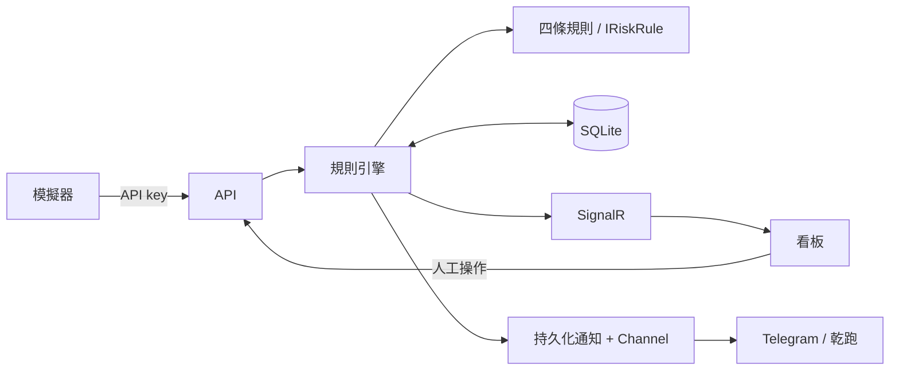

[English](README.md) | 繁體中文

# 交易風險告警服務

可設定交易風險規則、即時查看告警，並依幣別管理 Telegram 通知。

## 背景

從我在正式環境中建置及維運支付／會員平台的實務模式萃取而成。本專案以獨立重新實作的方式完成，所有資料皆為合成示範資料。

## 功能

- 四條可調整規則：單筆大額、短時間高頻、共用收款帳戶及獎勵／儲值比例過高。
- 事件冪等處理、證據時間窗、嚴重度升級及滾動指紋去重。
- SignalR 即時看板，提供篩選、接手、結案、來源事件及通知紀錄。
- 英文、繁體中文、韓文共用同一份文字目錄。
- 各幣別通知開關、最低嚴重度、Telegram MarkdownV2 及自動乾跑模式。
- 可重現的模擬流量、隔離的 SQLite 測試，以及外部通知的 HTTP 替身。

## 架構



元件、時序、狀態及資料模型請見[架構文件 (architecture.md)](docs/architecture.md)。

## 技術組合

.NET 10、ASP.NET Core Minimal API、EF Core SQLite、SignalR、Scalar、原生 JavaScript/CSS、xUnit、NSubstitute 及 WebApplicationFactory。看板從 CDN 載入固定版本 SignalR 8.0.7；其他執行元件不需要 CDN。

## 快速開始

安裝 SDK 版本設定檔 (global.json) 指定的版本，在專案根目錄執行：

```sh
dotnet restore RiskAlert.slnx
dotnet build RiskAlert.slnx --no-restore
dotnet run --project src/RiskAlert.Api --no-restore
```

開啟 `http://localhost:5107` 查看看板；`/scalar` 提供 API 操作介面，`/health` 提供存活檢查。另開終端執行：

```sh
dotnet run --project tools/RiskAlert.EventSimulator --no-restore -- --api http://localhost:5107 --scenario all --duration 60 --rate 5 --members 50 --seed 42
```

四個模擬回合內即可出現四種規則的告警。預設規則可偵測完全相同帳戶的情境；若要測試末碼相同的變體，先透過規則 API 將共用帳戶規則 (SHARED_PAYOUT_ACCOUNT) 的比對模式 (MatchMode) 設為末碼模式 (LastDigits)，再執行 `--scenario shared-account`。情境事件會額外加在 `--rate` 指定的每秒正常流量上。告警命中數 (alertHits) 同時包含新建與合併命中，不等於不同告警筆數。固定種子可重現流量選擇，每次執行的事件識別碼與時間仍保持唯一。長時間或高流量的正常交易也可能達到高頻門檻。

不需設定 Token：背景工作會保存乾跑內容，可從告警詳情查看。SQLite 存於 API 工作目錄的資料資料夾 (appdata)。CDN 無法載入時，看板仍每 15 秒更新；即時推播需要 CDN 可連線。

使用 Docker：

```sh
docker compose up --build -d api
docker compose --profile simulator up --build simulator
```

具名磁碟區保存 SQLite 資料；`docker compose down` 不會刪除該磁碟區。模擬器會等待 API 連接埠就緒。

## 設定

環境變數使用 `__` 分隔設定層級，請勿將憑證加入版本控制。

| 設定鍵 | 預設值 | 說明 |
| --- | --- | --- |
| 資料庫連線 (ConnectionStrings:RiskAlert) | `Data Source=appdata/risk-alert-notifier.db` | SQLite 路徑 |
| 進件金鑰 (Security:IngestApiKey) | `dev-ingest-key` | 交易端點要求 `X-Api-Key`，對外開放前必須替換 |
| 去重分鐘數 (Risk:DedupeWindowMinutes) | `30` | 未結案告警依最後命中時間滾動計算 |
| 大額規則預設 (Risk:Rules:LARGE_TXN) | KRW 10,000,000；USD/USDT 10,000 | JSON 字串，設定幣別與儲值／提領各自門檻 |
| 高頻規則預設 (Risk:Rules:VELOCITY) | 10 分鐘；儲值 5、提領 3 次 | JSON 字串，設定分鐘數與各類型次數 |
| 共用帳戶規則預設 (Risk:Rules:SHARED_PAYOUT_ACCOUNT) | 30 天、完全相符、6 碼 | JSON 字串，設定天數、模式及末碼數（1–6） |
| 獎勵比例規則預設 (Risk:Rules:BONUS_RATIO) | 7 天、0.5；最低儲值 KRW 100,000 或 USD/USDT 100 | JSON 字串，設定比例、天數及各幣別最低儲值 |
| 通知顯示時區 (Notifications:DisplayTimeZone) | `Asia/Taipei` | 與 UTC 一起顯示 |
| 機器人金鑰 (Notifications:Telegram:BotToken) | 空白 | 空白時啟用乾跑 |
| 預設通知對象 (Notifications:Telegram:ChatId) | 空白 | Telegram 預設目的地 |
| 通知語系 (Notifications:Telegram:Locale) | `en` | 支援 `en`、`zh-TW`、`ko`；未知值回到英文 |
| 看板公開網址 (Dashboard:PublicUrl) | `http://localhost:5107` | 通知中的落地連結 |

規則預設值只在資料庫缺少該筆設定時寫入。後續以資料庫為準，透過 `PUT /api/rules/{code}` 修改。設定快取保留 30 秒，更新後立即失效。特定幣別通知設定優先於 `*`；初始 `*` 設定為啟用、最低中等嚴重度。

要實際發送 Telegram，先透過 BotFather 的 `/newbot` 建立機器人並妥善保管 Token。傳訊息給機器人或將它加入目標群組，再於私人操作環境從機器人的 `getUpdates` 回應取得 `message.chat.id`；確認沒有衝突的 webhook。設定下列環境變數後重新啟動 API（PowerShell）：

```powershell
$env:Notifications__Telegram__BotToken = '<your-token>'
$env:Notifications__Telegram__ChatId = '<your-chat-id>'
$env:Notifications__Telegram__Locale = 'zh-TW'
$env:Dashboard__PublicUrl = 'https://alerts.example.test'
dotnet run --project src/RiskAlert.Api --no-restore
```

Compose 使用相同的環境變數名稱：把 `.env.example` 複製成 `.env`（不進版控），或在執行前先於終端設定。實際發送需要可對外連線的 HTTPS 與有效通知對象。請將看板放在私人環境：本示範僅驗證事件進件端點，其餘查詢、設定、人工操作、Hub 與看板都必須在實際部署前加入身分驗證、授權、傳輸加密、流量限制與秘密管理。

## API 操作流程

依上述步驟啟動 API、開啟看板並執行模擬器。以下為 POSIX shell 可複製範例；PowerShell 可改用 `curl.exe` 並調整引號。

```sh
# 每次使用唯一識別碼與當前 UTC 時間。
EVENT_ID="demo-$(date +%s)"
NOW=$(date -u +%Y-%m-%dT%H:%M:%SZ)
curl -sS http://localhost:5107/api/events/transactions \
  -H 'X-Api-Key: dev-ingest-key' -H 'Content-Type: application/json' \
  -d "{\"eventId\":\"$EVENT_ID\",\"memberId\":\"sample-member\",\"type\":\"Deposit\",\"amount\":60001,\"currency\":\"USD\",\"occurredAt\":\"$NOW\"}"
curl -sS 'http://localhost:5107/api/alerts?currency=USD&severity=Critical&page=1&pageSize=50'

# 貼上前一個回應的告警識別碼。
ALERT_ID='<alert-id>'
curl -sS "http://localhost:5107/api/alerts/$ALERT_ID"
curl -sS "http://localhost:5107/api/notifications?alertId=$ALERT_ID"
curl -sS -X POST "http://localhost:5107/api/alerts/$ALERT_ID/acknowledge" \
  -H 'Content-Type: application/json' -d '{"by":"demo-operator"}'
curl -sS -X POST "http://localhost:5107/api/alerts/$ALERT_ID/resolve" \
  -H 'Content-Type: application/json' -d '{"by":"demo-operator"}'
curl -sS 'http://localhost:5107/api/stats/summary?hours=24'

# 先關閉 USD 通知，再設定僅發送高或嚴重等級。
curl -sS -X PUT http://localhost:5107/api/notification-settings/USD \
  -H 'Content-Type: application/json' -d '{"enabled":false,"minSeverity":"High","chatIdOverride":null}'
curl -sS -X PUT http://localhost:5107/api/notification-settings/USD \
  -H 'Content-Type: application/json' -d '{"enabled":true,"minSeverity":"High","chatIdOverride":null}'

curl -sS http://localhost:5107/api/rules
curl -sS -X PUT http://localhost:5107/api/rules/SHARED_PAYOUT_ACCOUNT \
  -H 'Content-Type: application/json' \
  -d '{"enabled":true,"parameters":{"lookbackDays":30,"matchMode":"LastDigits","digits":6}}'
```

以相同事件識別碼 (eventId) 重送會回傳重複標記 (duplicate)，不再產生告警。批次接受 1–500 筆有效事件，依序處理，每筆事件各自具交易原子性，整批並非同一個資料庫交易。無效批次會在處理前拒絕。清單回傳項目 (items)、總數 (total)、頁次 (page) 與每頁筆數 (pageSize)。通知查詢最多回傳 500 筆；起訖篩選 (from/to) 查詢證據時間窗有交集的告警。統計計算回溯範圍內曾出現的不同告警列，合併多次仍計為一列。完整端點請見[請求範例 (RiskAlert.Api.http)](src/RiskAlert.Api/RiskAlert.Api.http)。

## 設計取捨

1. **小型規則介面。** 風險規則介面 (IRiskRule) 將判斷邏輯與儲存、HTTP 分開。時間窗依事件時間計算並包含兩端；高頻與獎勵比例不混算幣別。單一規則失敗會記錄並讓其他規則繼續。新增幣別須明確設定大額與最低儲值門檻。大額使用嚴格大於、高頻使用大於等於、獎勵比例使用嚴格大於。
2. **滾動指紋。** 規則、會員及含幣別的指紋鍵識別同一事件群。待處理與已接手告警在最後命中後 30 分鐘內合併，來源事件去重、時間窗擴大、嚴重度取最高。已結案告警不會重新開啟；合併告警只在嚴重度升級時再次通知。
3. **持久化前保護帳號。** 僅保留遮罩帳號、銀行／帳號的 SHA-256 雜湊，以及遮罩中原本就可見的末六碼作為索引；完整帳號會丟棄。完全相符比對使用銀行與正規化後的數字帳號。末碼模式比對 1–6 碼，戶名正規化後的 Levenshtein 相似度須至少 0.85。戶名只留在私人資料庫供比對，不放入來源事件回應。確定性雜湊不是加密，實際部署仍需資料保留政策與存取控管。
4. **降噪並保存紀錄。** 幣別開關與最低嚴重度會留下跳過紀錄及原因。Channel 背景工作在進件交易完成後發送，待送資料可於重啟後恢復。首次失敗後重試三次（2、4、8 秒），429 優先採用回應的等待秒數 (retry_after)。採至少一次傳遞：遠端成功後、資料庫更新前若當機，可能重送。失敗紀錄可查詢，但未提供自動重播端點；目的地覆寫值在開始發送時讀取，是否符合政策則在排入時決定。
5. **預設乾跑。** 機器人金鑰未設定時，保存本來會送出的跳脫文字，通道為乾跑 (DryRun)。日誌只記錄通知識別碼與結果，不寫會員識別碼、完整帳號、負載或 Token；Telegram URL 內含 Token，因此停用該 HTTP 用戶端的日誌。
6. **共用文字與安全格式。** 看板與通知使用同一份三語目錄。MarkdownV2 特殊字元及反斜線都會跳脫；通知同時顯示 UTC 與設定時區，金額使用固定千分位與各幣別小數位。
7. **保留證據連結。** 通知網址含告警識別碼與時間窗。看板會開啟該筆詳情並套用時間篩選。輸入欄位使用 UTC，事件顯示時間則依瀏覽器本地時區。
8. **定點金額。** 核心金額使用十進位型別 (decimal)，SQLite 以四位小數縮放的整數型別 (long) 儲存，避免浮點誤差及文字比較問題。進件拒絕非正數、超過四位小數及大於 100,000,000,000,000 的金額。UTC ticks 保留時間排序能力。啟動建庫方法 (EnsureCreatedAsync) 適合可重建的示範資料；長期部署應導入版本化結構遷移。
9. **單一 API 程序。** 全域閘門序列化進件、設定與人工操作，使 SQLite 去重具一致性。多執行個體須改用資料庫鎖定／並行控制與分散式寄件匣。記憶體 Channel 沒有容量上限，正式環境應補背壓與恢復掃描；服務不會自動限制會員帳號。

## 測試

```sh
dotnet build RiskAlert.slnx --no-restore
dotnet test RiskAlert.slnx --no-restore
```

測試涵蓋四條規則、嚴重度邊界、幣別與時間隔離、兩種帳戶比對、隱私、去重、通知政策、三語全部鍵、固定金額格式與 Markdown 跳脫。外部 HTTP 使用處理器替身，涵蓋 429、重試耗盡及 Token 日誌檢查。整合測試使用各自獨立的暫存 SQLite、可控時間、廣播替身與實際 HTTP 端點，驗證冪等、並行重複進件、金鑰驗證、人工狀態轉換、設定失效及精確金額儲存。

人工驗收：觀察看板動畫及窄螢幕詳情、發送一則真實 Telegram 到私人目的地，以及建置並啟動 Docker 映像。分別需要瀏覽器／CDN、憑證，以及可用的容器引擎。

## 專案結構

```text
src/RiskAlert.Core/                 模型、規則、去重與文字格式
src/RiskAlert.Infrastructure/       SQLite、設定、處理與通知背景工作
src/RiskAlert.Api/                  端點、Hub、設定及靜態看板
tools/RiskAlert.EventSimulator/     合成交易模擬器
tests/RiskAlert.Tests/              單元、通知與整合測試
docs/architecture.md               架構與證據流程
```

## 後續方向

- 加入可信任的操作人員身分與結案稽核資料。
- 持久化有界佇列、恢復掃描、多執行個體並行處理、資料保留與遷移。
- 規則效能指標與其他通知通道。
- 自行託管看板用戶端資源與瀏覽器自動化測試。

## 授權

[MIT](LICENSE)。
