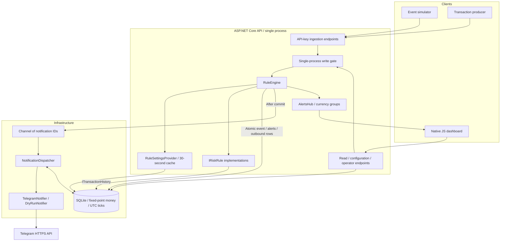
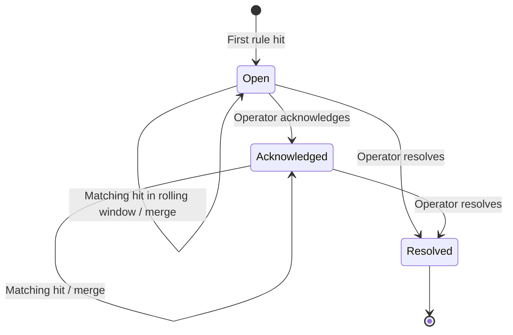
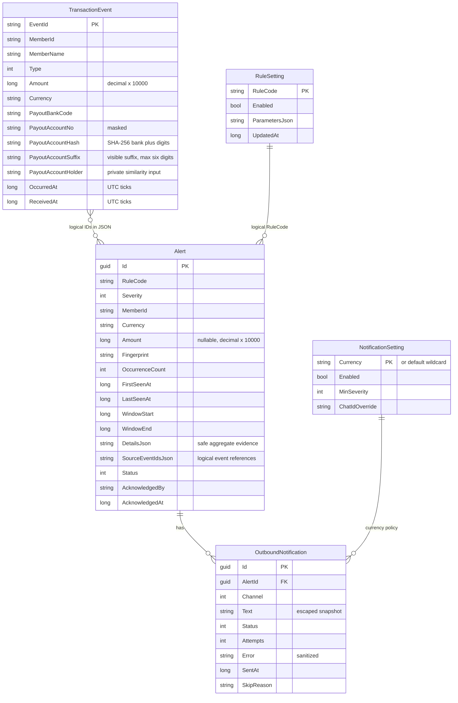

# Architecture

## Components



Only ingestion authenticates requests in this demonstration. All other endpoints and hub access must be protected before real use. Full payout numbers are transformed to masks and hashes before persistence. Source-event responses exclude holder, hash, and suffix-index fields.

## Event and delivery sequence

```mermaid
sequenceDiagram
  participant C as Producer
  participant A as Ingestion API
  participant E as RuleEngine
  participant D as SQLite
  participant R as Rules
  participant H as SignalR
  participant W as Notification worker
  participant T as Telegram / dry-run
  C->>A: POST event + X-Api-Key
  A->>A: Validate identity, money, currency, date
  A->>E: ProcessAsync
  E->>E: Acquire process-wide gate
  E->>D: Check EventId
  alt Already persisted
    E-->>A: duplicate=true, alerts=[]
  else New event
    E->>D: Begin transaction; save protected event
    loop Each enabled rule
      E->>R: Evaluate with parameters and event-time window
      R->>D: Query history including current event
      R-->>E: Rule hits or isolated error
      E->>E: Merge active fingerprint / create alert
      E->>D: Save alert and Pending / Skipped outbound row
    end
    E->>D: Commit
    E->>W: Enqueue pending IDs
    E->>H: alertRaised / alertUpdated
    E-->>A: Event result and changed alert IDs
    A-->>C: HTTP 200
  end
  E->>E: Release gate
  W->>D: Read Pending row; save attempt count
  W->>T: Send snapshot text
  alt Success
    W->>D: Sent + SentAt
  else Failure
    loop Up to three retries
      W->>W: Wait 2/4/8 seconds or retry_after
      W->>T: Retry
    end
    W->>D: Sent or Failed
  end
```

Pending rows are loaded into the channel at startup. The transport can duplicate a message if the process stops after remote success but before recording it. A pending row with four persisted attempts becomes failed on recovery. An unexpected database failure leaves pending rows for restart; there is no periodic recovery scanner. Broadcast failures do not roll back committed evidence. Batch events use individual transactions and may partially complete if interrupted.

## Alert lifecycle



The same fingerprint after resolution or outside the deduplication window creates a new alert. Merging increments occurrence count, advances last-seen time, widens the evidence window, unions source event IDs, and retains the maximum severity. Notifications for merged alerts require a severity increase. Acknowledgment stores operator/time; resolution currently stores only status, so authenticated resolution audit metadata remains future work.

## Data model



Only the outbound alert relationship is an enforced foreign key; evidence and configuration relationships are logical. Composite indexes cover member/type/time, masked payout/time, payout hash/time, suffix/time, and alert fingerprint/status. Monetary storage avoids floating point and SQLite TEXT comparisons. Shared-account evidence may span currencies; velocity and bonus calculations never add unlike currencies. The default shared-account mode is exact; suffix mode requires holder similarity of at least 0.85 and can generate false positives for human review. This service only alerts and never modifies member access or funds.
